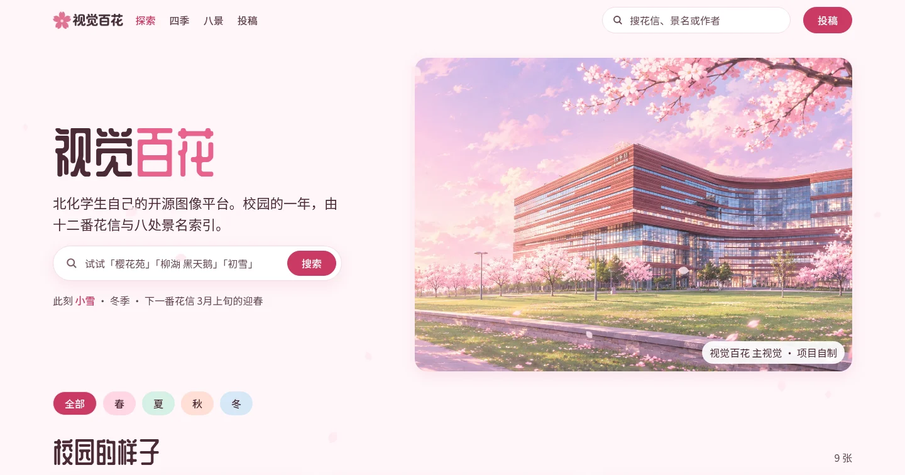
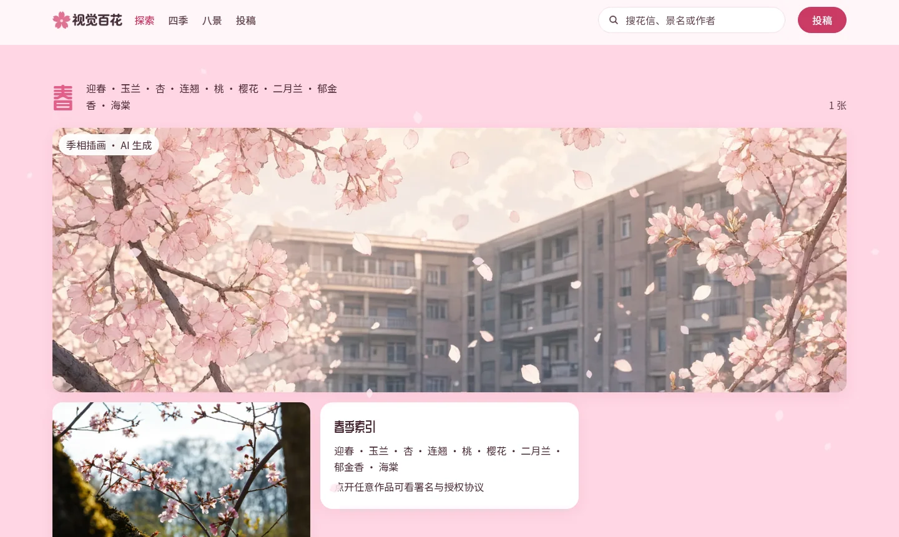
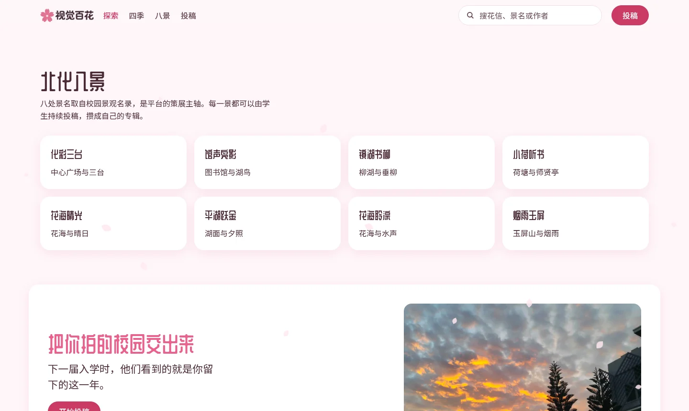
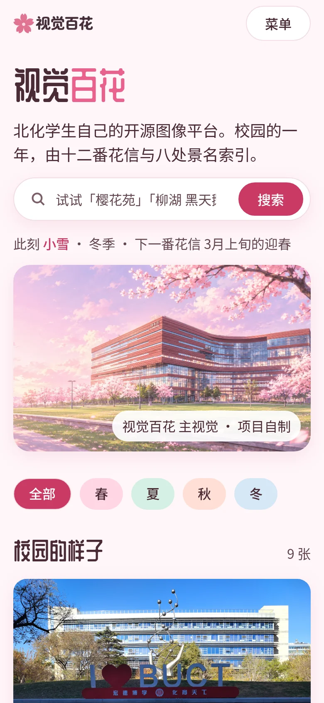
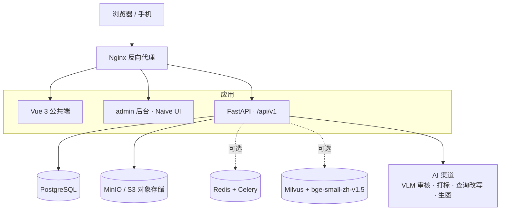

<div align="center">


# 视觉百花 · Sakura Gallery

**北化学生自己的开源创作资源共享平台。**

校园的一年，由十二番花信与八处景名索引。<br>
摄影、AI 生成图像与模板素材，共用同一套发布、检索、互动与授权机制。

<br>


<br>

[产品一览](#产品一览) · [核心机制](#核心机制) · [技术架构](#技术架构) · [快速开始](#快速开始) · [路线图](#路线图) · [开发指南](AGENTS.md)

</div>

---

> **不是图库，是创作资源的共享与再创作基地。**
>
> 前身是审核前置的校园媒体资产管理系统「视觉北化 / Visual BUCT」：
> 作品为宣传任务服务，投稿要排队等管理员，原图被裁成统一比例，公开页面上作者露出的是学号。
> 这一版把「先审后发」改成「作者自助发布」，把「统一裁切」改成「保留原始构图」，
> 把「资产入库」改成「署名与授权随作品走」。

## 为什么是「视觉百花」

北化的校园叙事本来就在，我们只是把它做成了产品结构——

- **宿舍以花命名**：樱花苑、玉兰苑、紫竹苑、杏坛苑，「百花」有实指，不是修辞
- **一春十二番花信**：迎春、玉兰、杏、连翘、桃、樱花、二月兰、郁金香、海棠、紫花地丁、牡丹、芍药
- **景观名录里有北化八景**：化彩三台、馆声凫影、镜湖书柳、小荷听书、花海晴光、平湖跃金、花海聆淙、烟雨玉屏
- **一年有四季色域**：春粉、夏绿、秋橘、冬蓝，整块色域只承载大字，正文一律深墨

所以探索页的顶端是「此刻」——按节气算出现在是什么季节、下一番花信何时开；
照片按**原始宽高比**排进瀑布流，不裁切、不拉伸；
每张作品都带着作者署名与授权协议。校园的时间与地点，就是平台的信息架构。

## 与旧版相比，变了什么

| 维度 | 旧版资产库 | 视觉百花 |
|---|---|---|
| 发布 | 先审后发，等管理员 | **三级发布**：原创免审即发，推荐位需评审，高风险强制前审 |
| 构图 | 统一裁成 3:2 / 2:3 | **原图不裁切**，瀑布流按真实比例排列 |
| 作者 | 学号 + 真名对外可见 | **用户名 + 署名 + 授权协议**，学号永不公开 |
| 类型 | 单一摄影 | `works` 基表 + `kind`：摄影 / AIGC / 模板共用一套机制 |
| 审核 | 人工逐张 | **Agent 辅助**：规则前置 + VLM 快筛 + 推理复核，人做终判 |
| 合规 | 事后补 | **内建**：AIGC 法定标识、隐私白名单、字体风险标注 |
| 部署 | 单机手工部署 | 开放 API、可自部署，向「`docker compose up` 一键起」收拢 |

## 产品一览

> 以下为公共端设计原型 [`design/index.html`](design/index.html) 的真实截图（浏览器直接打开即可交互，纯静态）。
> 原型中的照片为 Wikimedia Commons 开放授权占位素材，接入真实投稿后替换。



<p align="center"><sub><b>探索页</b> · 「此刻」按节气定位 · 十二番花信做浏览轴 · 按真实宽高比排瀑布流</sub></p>

| 四季色域 | 北化八景 |
|:---:|:---:|
|  |  |
| 春 / 夏 / 秋 / 冬 四套淡色域，一季一索引 | 八景取自真实景观名录，每景可由学生持续投稿 |

<p align="center">

<br>
<sub><b>390px 手机端</b> · 同一套信息架构重排 · 桌面 / 平板 / 手机三宽度门禁实测 0 FAIL / 0 WARN</sub>
</p>

## 三类内容

不是三个产品，是同一套「作品」机制的三个分型：

| 类型 | `kind` | 内容 | 优先级 |
|---|---|---|---|
| **摄影** | `photo` | 校园摄影作品，按季节 / 花信 / 校区 / 八景索引 | 主 |
| **AIGC** | `aigc` | AI 生成图像，带法定显式与隐式标识，可公开提示词与参数 | 主 |
| **模板** | `template` | PPT 等模板素材，自动预览、字体清单与授权风险标注 | 次 |

统一的 `works` 基表 + `kind` 判别 + 分类型元数据表。
一个作品从上传、审核、检索到详情页的体验一致，但摄影的 EXIF、AIGC 的提示词、模板的字体清单各自有自己的位置。

## 核心机制

### 三级发布：自由度与底线同时存在

| 级别 | 含义 | 处理 |
|---|---|---|
| **L0** | 原创摄影、合规 AIGC、字体风险已标注的模板 | **免审即发**，直接进最新流 |
| **L1** | 进首页精选 / 八景专辑 / 搜索加权 | 需人工或社区评审 |
| **L2** | 涉可识别人物、疑似侵权或深伪 | **强制前审**，未通过不进公开流 |

用户自助建专辑、自定义标签、装修个人主页，**不需要管理员批准**。

### Agent 审核：把重复判断交给机器，把终判留给人

审核链路分三层，模型与延迟均为实测值（设计已定稿，M3 落地）：

1. **规则前置**（不花模型钱）——GPS 存在性、感知哈希查重、AIGC 元数据探测、
   PPTX 字体清单抽取、文件类型与体积校验
2. **快筛 VLM** —— `qwen3-vl-plus`，实测 **1.9s / 57 输出 tokens**，输出结构化判定：
   `has_identifiable_person / likely_aigc / sensitive / copyright_risk / suggested_tier / reason`
3. **推理复核** —— `deepseek-v4.1-flash`，实测 **4.7s / 590 输出 tokens**，
   只处理快筛判为 L2 或置信度低的样本，不跑全量

审核任务**入队即落库**（durable queue），API 进程内嵌 worker 每 5s 兜底轮询，
PG `FOR UPDATE SKIP LOCKED` 保证多 worker 不重复领取、滚动重启不丢任务；
人工队列展示 agent 判定、依据与原图，**人做最终决定**。
成本有日预算护栏，超预算自动降级为纯规则 + 人工，不阻塞发布。

### AIGC 合规四件套：缺一不可放行

依《人工智能生成合成内容标识办法》（2025-09-01 施行），AI 生成内容必须：

1. **上传时强制声明**——不声明不能进 `aigc` 分型；摄影流里探测到 AIGC 元数据会提示改投
2. **展示时显式标识**——列表角标 + 详情页说明，文案明确「AI 生成」
3. **下载时写入隐式标识**——文件元数据（XMP / EXIF）带标识字段，写入结果入库
4. **图生图 / 换脸类额外限制**——强制前审，不适用 L0 免审

### 作者、隐私与授权

- **公开响应白名单**：不含学号、真实姓名、完整 EXIF；公开身份只用 `username` / `display_name`
- **GPS 入库即剥离**：公开变体不携带定位信息
- **原图只读**：保留原始构图，禁止裁切；变体长边 320 / 640 / 1080 / 1600 / 2400，WebP 主用 + JPEG 兜底
- **授权随作品走**：投稿时选定授权协议，详情页展示并可复制引用署名
- **字体风险明示**：模板抽取字体清单并标注风险等级，**不硬拦不拒收**，把判断交给下载者

## 技术架构



| 层 | 选型与职责 |
|---|---|
| 前端 | Vue 3.5 + Vite 7 + TypeScript + Naive UI + Tailwind 4；admin 后台沿用 Naive UI |
| 后端 | FastAPI + SQLAlchemy 2 + Alembic 迁移；RBAC、审计日志、通知、收藏已具备 |
| 数据 | PostgreSQL（生产），本地开发默认 SQLite；`pg_trgm` + `tsvector` 做跨类型全文检索 |
| 资产 | MinIO / S3 对象存储；图片变体预生成，Nginx 反代或预签名 URL 直出，不经 Python 流式转发 |
| 可选增强 | Redis + Celery（默认 BackgroundTasks）；Milvus 语义检索缺失时优雅降级 |
| AI | 统一原语 `backend/app/services/ai_client.py::chat_json()`（渠道解析 / 预算闸门 / 重试 / JSON 修复 / 用量落库）；快筛 VLM `qwen3-vl-plus` + 难例复核 `deepseek-v4.1-flash-1017`；生图走百炼异步 |
| 交付 | `deploy/docker-compose.prod.yml` 一键起（PostgreSQL + uvicorn --workers 2 + nginx）；面向 2c4g 单机，逐步上机文档见 [`docs/DEPLOY_2C4G.md`](docs/DEPLOY_2C4G.md) |

## 快速开始

<details>
<summary><b>展开：本地把项目跑起来</b>（约 5 分钟）</summary>

### 后端

```bash
cd backend
python3 -m venv .venv && source .venv/bin/activate
pip install -r requirements.txt
alembic upgrade head
uvicorn app.main:app --reload --port 8000
```

本地默认使用 SQLite，无需先装 PostgreSQL。创建管理员（口令从环境变量读取，
未提供则随机生成并打印一次；在**仓库根目录**执行，脚本会自行定位 `backend/`）：

```bash
ADMIN_EMAIL=you@example.edu.cn ADMIN_PASSWORD='your-strong-password' \
  python3 scripts/create_admin.py
```

### 前端

```bash
cd frontend
npm install
npm run dev
```

- 前端 http://localhost:5173
- API 文档 http://localhost:8000/docs
- 新版公共端设计原型：直接用浏览器打开 [`design/index.html`](design/index.html)（纯静态，无需构建）

> 新版公共端已落进 `frontend/src`（首页 / 探索页 / 详情页 / Agent 检索页 / 审核队列），
> `design/` 中的原型保留作设计参照；admin 后台沿用 Naive UI 不动。
> 生产构建用 `npm run build` 后 `npm run preview` 验证（预览端口 5175，`/api` 反代到 8001）。

### 配置

复制 `backend/.env.example` 为 `backend/.env`；生产部署复制 `deploy/.env.prod.example` 为 `deploy/.env.prod`（`chmod 600`，绝不入库）。
**真实凭据不提交仓库**，脚本通过环境变量读取：

| 变量 | 用途 |
|---|---|
| `SECRET_KEY` | JWT 签名（生产必须自定义，否则拒绝启动） |
| `DATABASE_URL` | 数据库连接（本地默认 SQLite） |
| `S3_ENDPOINT` / `S3_BUCKET` / `S3_ACCESS_KEY` / `S3_SECRET_KEY` | 对象存储 |
| `DEPLOY_SERVER` / `DEPLOY_USER` / `DEPLOY_HOST` / `SUDO_PASS` | 部署脚本（本地未跟踪） |

### 测试

```bash
cd backend && pytest
```

更多部署细节见 [`DEPLOY.md`](DEPLOY.md)，接口清单见 [`docs/API.md`](docs/API.md)，
线上排障见 [`docs/SOP.md`](docs/SOP.md)。

</details>

## 项目状态（诚实版）

产品方向已经定稿，工程在按里程碑推进。**路线图是目标，不是承诺**：

| 部分 | 现在 |
|---|---|
| 公共端设计原型 | ✅ 已完成，1440 / 768 / 390 三宽度门禁 0 FAIL / 0 WARN |
| 新版公共端工程 | ✅ 已落地 `frontend/src`（首页 / 探索页真瀑布流 / 详情页 / Agent 检索页 / 审核队列 / **樱花风投稿页** / AIGC 声明摘要卡 / 响应式图 srcset），1440 + 390 截图验收 |
| 数据模型 | 🚧 M0 未做：`works` 基表 + `kind` 判别 + 三张元数据表（当前仍以 `photos` 单表承载） |
| 资产管线 | ✅ 取消强制裁切、**上传即生成 5 档响应式变体**（WebP+JPEG，`/image/variant/{size}`）、LQIP、GPS 剥离、媒体长缓存/预签名 |
| 隐私修复 | ✅ 公开响应白名单化（学号 / 真实姓名 / 完整 EXIF 不再公开） |
| 账号 | ✅ 登录支持学号 / 邮箱 / **username**；公开身份仅 username + display_name |
| 登录 / 注册 / 邮箱验证 | ✅ 2026-11-24 邮箱验证码（register/login/reset/verify 四用途、限流+冷却+HMAC 哈希）、免密登录、找回密码、登录失败锁定；管理端用户统计/筛选/手动验证邮箱 |
| 策展专题 | ✅ `collections` / `collection_photos` 两张表 + 公开列表/详情/作品「收录于」接口；12 个真实专题（七乐章 / 校园四季 / 年度精选 / 月度随笔 / 手机摄影），首页横滑卡区与专题详情页由前端消费 |
| 光的一日 | ✅ 2026-11-24 按 `captured_at` 自动分 晨 / 昼 / 暮 / 夜 四个专题（`scripts/seed_curation.py` 幂等生成，空专题自动 draft） |
| 樱色光谱 | ✅ 2026-11-24 缩略图主色采样归入 樱粉 / 金 / 绿 / 蓝 / 墨 五色卡，`GET /api/v1/collections/spectrum` |
| 作者手账 | ✅ 2026-11-24 用户自建专辑 CRUD（无需审核、只能收自己 approved 作品、空专辑不进公开列表），公开页展示作者 |
| 人像隐私分级 | ✅ 2026-11-24 后端分级 + 脱敏图 + 访问控制；前端探索页「显示人像作品（已脱敏）」开关、卡片/详情脱敏徽标与隐私说明、非作者隐藏下载 |
| SEO（robots/sitemap/OG/标题） | ✅ 2026-11-24 |
| 易用性（搜索历史/快捷键/批量审核/个人中心 tabs） | ✅ 2026-11-24 |
| 易用性提升 | ✅ 2026-11-24 探索页筛选与滚动位置恢复、回到顶部、Lightbox 键盘/双击操作提示 |
| AI 成本观测 | ✅ 2026-11-24 `GET /api/v1/admin/ai/usage`（总量/按日/按链路/按模型 tokens 与 USD + 最近事件），后台「AI 成本」页（7/30/90 天、成本占比、失败行高亮） |
| 分享卡（OG） | ✅ 2026-11-24 `/api/v1/share/photo/{id}`、`/api/v1/share/collection/{slug}` 生成 OpenGraph/Twitter 卡片；nginx 按 UA 把爬虫/IM 抓取路由到 HTML、普通用户仍走 SPA；敏感与未发布一律 404 |
| 内容举报 / 侵权投诉 ✅ | `POST /api/v1/reports` + 管理端受理下架；服务条款 `/terms`、隐私政策 `/privacy`（2026-11-25） |
| 移动端与可访问性 | ✅ 2026-11-24 触屏可点 ≥44px、全站 focus-visible、Skip link、灯箱 Tab 焦点陷阱与焦点归还、图片 alt/label 补全、reduced-motion 降级、图片渐显 420ms、18 组合（390/768/1440×6 页）无横向溢出 |
| 收藏 | ✅ 详情页收藏按钮 + `GET /photos/favorites/my` 返回可直接渲染的公开作品分页（只含 approved）；前端「我的收藏」页（列表/加载更多/空态）+ 个人中心入口 |
| Agent 审核 | ✅ 规则前置 + VLM 快筛 + 难例复核 + 自动放行 + 人工队列 API；队列持久化（重启不丢、SKIP LOCKED 防重复领取） |
| Agent 检索 | ✅ pg_trgm + tsvector + 汉字二元组，意图分解 / 多 facet / 解释 / 澄清追问答 |
| 审核即打标 | ✅ 复用快筛同一次 VLM 输出落 `tags`/`photo_tags` 与 `photo_classifications`（分类目录约束 + 幂等 + 失败不影响审核）；存量回填脚本 `scripts/backfill_auto_tags.py` |
| AIGC 法定标识 | ✅ 上传强制声明 + 显式角标/详情 + 下载 XMP 隐式标识 + 图生图/换脸限制（M2 四件套） |
| 视觉相似 / 以图搜图 | ✅ 2026-11-25 dhash + 光谱色卡 + 构图/标签/季节/校区加权，详情页「视觉相似」带中文理由；`POST /api/v1/search/visual` 上传图内存算签名直接搜（不落盘/不花 AI 钱） |
| 画面笔记 / 检索语料 | ✅ 2026-11-25 详情页 AI 画面描述 + 标签检索语料（`search_document` + trigger），公开热门关键词接口；旧图跑 `scripts/backfill_search_documents.py` |
| 按光找图 | ✅ 2026-11-25 `/search` 与 `/photos/public` 接受 `period=dawn|noon|dusk|night`，探索页「光」筛选条与 URL 同步，agent 能识别「黄昏/清晨」等口语 |
| 多轮追问 | ✅ 2026-11-25 `/search` 接受重复参数 `history`（最近 3 轮），planner 在省略式追问（「那黄昏呢」「还有春天的吗」）时承接上文条件，规则兜底不依赖模型 |
| 创作者主页 | ✅ 2026-11-25 `/u/{username}` 公开创作者主页：资料 + 作品统计（浏览/收藏）+ 作品瀑布流 + 作者作品集 rail；详情页作者名可点；`GET /api/v1/creators/{username}`（30s 微缓存） |
| 创作者名录 | ✅ 2026-11-25 `/creators` 发现页 + 首页创作者 rail：有公开作品的创作者按作品数/浏览数排序，卡片带 ≤3 张封面；`GET /api/v1/creators?sort=works|views`；sitemap 收录 `/u/{username}` |
| 观展模式 | ✅ 2026-11-25 详情页跨作品上一张/下一张 + 灯箱胶片条（`GET /photos/{id}/neighbors?context=latest|collection:<slug>`）；PublicLayout 对详情页用固定 key，翻页原地替换、灯箱不重挂载；专题进入带 `?from=collection:<slug>` 保持序列 |
| 作者工作台 | ✅ 2026-11-25 `/my-submissions` 重做为作者工作台（概览计数 `GET /photos/my-submissions/stats`：总/待审/已通过/未通过/复核中；删除作品时清理原图/缩略图/压缩图/响应式变体/脱敏图，修掉孤儿文件泄漏） |
| 站内通知 | ✅ 2026-11-25 公共端铃铛 + `/notifications` 通知中心：全部/未读、全部已读、作品深链、60s 未读数轮询；类型标签覆盖过审/驳回/复核/权限/系统 |
| 账号自助注销 | ✅ 2026-11-25 个人中心「账号与安全」输入密码 + 「注销」确认；单事务删除作品/变体/脱敏图/AI 草稿/专辑/收藏/通知，审计脱敏保留，最后一位管理员不可注销 |
| 注册准入 | ✅ 2026-11-25 注册开关（`REGISTRATION_ENABLED`）+ 邀请码（`REGISTRATION_INVITE_CODE`）+ 公开配置接口；注册写欢迎通知、审批放行通知，前端注册后自动登录 |
| 审核复核 | ✅ 2026-11-25 被驳回作品作者可提交一次申诉（`POST /photos/{id}/appeal`）；后台 `/admin/appeals` 受理，accept 后作品回到 pending 重新审核并通知作者；重复受理 409 |
| AI 策展助手 | ✅ 2026-11-25 一句话主题 → 从作者自己的 approved 作品里挑 3–24 张、按观展顺序给理由，返回可编辑专辑提案（不落库，编辑页确认后创建） |
| 策展自动归档 | ✅ 2026-11-25 过审/自动放行自动加入「光的一日」「樱色光谱」，驳回/下架自动移出；敏感作品不归档；`scripts/sync_curation_membership.py` 幂等回填 |
| AI 创作台 | ✅ 2026-11-25 站内提示词生图（百炼 qwen-image-3.0-pro，约 50–60s/张）→ 草稿预览 → 用普通上传发布为待审 AIGC 作品；每日额度、3/min 限流、草稿不对外公开 |
| 2c4g 部署包 / 云主机上线 | ✅ compose / Dockerfile / nginx / env 模板 / 迁移入口 / 备份脚本；**已在腾讯云 2C4G 云主机上线**（Docker + 腾讯 COS + Cloudflare Tunnel + 自带域名，见 docs §15）；**容量已用 cgroup 模拟 2 vCPU 压测**（混合读 49→301 req/s，上传峰值 472MB，见 docs §14）；**S3/COS 路径已全链路验证**（307 预签名 + 对象元数据 + AIGC 下载写 XMP，见 docs §6.5） |
| 生产可靠性 | ✅ 2026-11-24 就绪检查 `/health/ready`（DB 不可达 503）；COS 异地备份 + 从对象存储恢复演练通过；每 5 分钟可用性巡检（异常/恢复邮件告警）；HSTS 等安全响应头 |
| 旧版单类型系统 | ✅ 摄影类型下可用，admin 后台保留 |
| 模板专区 | ◻️ M6：S3 直传 + LibreOffice 预览 + 字体清单 |
| 开源 v1.0 | ◻️ M7：凭据轮换、git 历史清洗、CI、LICENSE |

已具备的后端能力：上传与批量导入、Agent 审核（`/api/v1/admin/moderation/*`）、
Agent 检索（`/api/v1/search?mode=agent|fast` + facets/suggest/traces）、taxonomy 多维分类、
RBAC、审计日志、站内通知、收藏、浏览统计。
审核与检索的架构、配置项、成本实测与降级矩阵见 [`docs/AI_PLATFORM.md`](docs/AI_PLATFORM.md)。

## 路线图

八个里程碑，每项都有可验收判据，详见 **[`docs/ROADMAP.md`](docs/ROADMAP.md)**。

| 里程碑 | 日期 | 主题 |
|:---:|:---:|---|
| **M0** | 11/24 – 11/30 | 地基：`works` + `kind` 数据模型、资产管线、隐私修复 |
| **M1** | 12/01 – 12/07 | 品牌资产、公共端骨架、探索页真瀑布流 |
| **M2** | 12/08 – 12/14 | AIGC 专区（法定标识链路） |
| **M3** | 12/15 – 12/21 | Agent 审核（规则 + 快筛 + 复核） |
| **M4** | 12/22 – 12/28 | 检索与 Agent 搜索 |
| **M5** | 12/29 – 01/04 | 详情页、摄影师主页、社区互动 |
| **M6** | 01/05 – 01/11 | 模板专区 |
| **M7** | 01/12 – 01/18 | 开源发布 v1.0 |

**关键路径**：M0 → M1 → M5。资产管线不先做完，真瀑布流没有素材可排；M2 与 M1 可并行，M4 与 M3 可并行。

**实际进度（2026-11）**：M1（公共端）、M2（AIGC 法定标识四件套）、M3（Agent 审核）、M4（Agent 检索）
的核心能力已提前交付并带测试；M0 的 `works` 基表重构与 M6（模板）仍待做；
M7 的"一键起"已由 `deploy/docker-compose.prod.yml` 覆盖（上机步骤见 `docs/DEPLOY_2C4G.md`）。

## 设计系统

樱花粉柔色系 + 二次元取向。全部对比度为脚本实测，非目测。

```text
底 #fff6f9   卡面 #ffffff   墨 #4a2b35   次级 #63474f
主色 #c93a63（按钮 / 链接，4.9:1）   标题粉 #e8628c（大字 3.2:1）
四季淡底 春 #ffd7e4  夏 #d4f0e4  秋 #ffdfd6  冬 #d6e8f7（深墨字 9.5–10.3:1）
季相强调 春 #e36089  夏 #3b9c80  秋 #b5703c  冬 #5692c8
```

- 标题字 **站酷庆科黄油体**（自托管，92 个 unicode-range 分片），正文 Noto Sans SC
- 圆角：卡 20px / 照片 16px / 控件全圆角；柔影 `0 6px 24px rgba(201,58,99,.10)`
- **CJK 行宽用 `em` 不用 `ch`**（`ch` 在中文下约半个汉字宽，会拆断词）
- 品牌资产在 [`design/brand/`](design/brand/)：组合标、纯中文版、反色版、图形标、
  「北化创作者」认证徽章、1200×630 社交分享图、favicon 全套（16/32/48 用实心简化版）

完整色板、字体与踩坑记录见 [`design/DIRECTION.md`](design/DIRECTION.md)。

## 合规

- **AIGC 标识**：依《人工智能生成合成内容标识办法》（2025-09-01 施行），
  AI 生成内容须带显式标识（角标与说明）与隐式标识（下载文件元数据），四件套缺一不可放行
- **个人信息**：公开响应不含学号、真实姓名、完整 EXIF；GPS 入库即剥离；学号永不公开
- **肖像权**：涉可识别人物需被摄者同意，走 L2 强制前审
- **字体授权**：非商用**不豁免**著作权，分发行为本身即需授权；策略是抽取清单、标注风险、详情页明示，
  推荐使用思源 / 霞鹜 / 站酷等开源免费商用字体

## 安全说明

**本仓库工作区已脱敏**，不含服务器地址、账号、口令或密钥。

⚠️ **但 git 历史中仍存有早期提交的真实凭据，且本仓库曾公开。**
如果你 fork 或克隆过 2026-11 之前的版本，请视为凭据已泄露：
**轮换是唯一有效补救**，清洗历史只是卫生。相关处置见路线图 M7。

发现漏洞请勿公开提 Issue，先私下联系维护者。

## 贡献

欢迎贡献代码、设计、种子内容与审核经验。

- Commit 标题用简短英文命令句概括改动（与现有历史一致），例如
  `Return clear taxonomy node validation errors`；需要展开时写在正文
- 开发约定、架构、合规细节统一见 **[`AGENTS.md`](AGENTS.md)**，不要在多个文档里复制规则
- 提交前请确认：
  - 不含任何凭据、服务器地址或账号
  - 不在公开响应中暴露学号、真实姓名、完整 EXIF
  - 不裁切用户原图构图
  - AIGC 内容带显式与隐式标识

## 许可证

代码许可证待定（AGPL-3.0 或 MIT，见路线图 M7）。
摄影与插画素材依各自作者所选协议，见 [`design/assets/credits.json`](design/assets/credits.json) 与页面署名。

## 第三方素材

`design/assets/photo/` 中的摄影作品来自 Wikimedia Commons，依各自 CC 协议使用，
作者与协议见 `design/assets/credits.json` 与原型页脚署名。
它们**不是北化学生投稿**，是设计占位，接入真实作品后须替换。

`design/assets/art/` 的插画为 AI 生成（阿里云百炼 `qwen-image-3.0-pro`），页面明确标注，不冒充摄影作品。
首屏主视觉为项目自制。字体：站酷庆科黄油体与 Noto Sans SC，依 SIL Open Font License 使用。

## English

Sakura Gallery is a student-run, open-source creative resource platform for
Beijing University of Chemical Technology (BUCT): campus photography, AI-generated
images and slide templates in one publishing, discovery and licensing system.
The campus year is indexed by twelve flower-signs and eight named campus views.
Design principles: real aspect ratios (no cropping), author attribution,
privacy whitelist, and legal AIGC labeling. Stack: Vue 3 · FastAPI · PostgreSQL.

<div align="center">
<br>
<sub>视觉百花 · 为每一届入学的人，留下上一届看到的校园。</sub>
</div>
